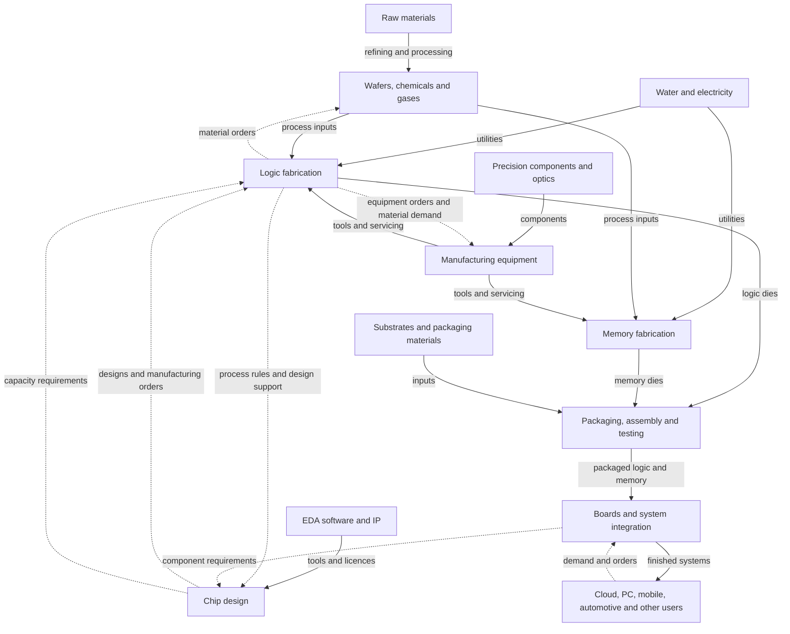

# Map of the Semiconductor Space

The general approach here is that I noticed that NVIDIA, AMD, Broadcom, TSMC, Micron, Intel, and ASML seem to move together in the market. The goal is to map out who supplies whom, what resources are required, and how these companies connect to the underlying materials. Whether those links explain their share-price movements remains a research question.

# General Overview of Selected Companies

| Company | What it does | Where it sits in the supply chain | Who it sells to | Who it requires | Material exposure |
|---|---|---|---|---|---|
| NVIDIA | Designs GPUs and other chips; builds hardware and software platforms | Fabless design and systems | Cloud providers, system builders, enterprises, and gaming customers | Foundries including TSMC and Samsung; memory from SK hynix, Micron, and Samsung; packaging and contract manufacturers | Through purchased chips, memory, boards, and systems. The named memory suppliers cover memory generally; HBM relationships need product-level checks. [Filing][nv] |
| AMD | Designs CPUs, GPUs, and adaptive computing products | Fabless design | Data-centre, PC, gaming, and embedded customers | TSMC; GlobalFoundries for some older process nodes; other foundries and assembly/test partners | Through outsourced wafer fabrication, packaging, and components. [Filing][amd] |
| Broadcom | Designs semiconductor solutions and supplies infrastructure software | Mainly outsourced chip production, with some internal fabrication | Cloud, networking, device, and enterprise customers | Foundries including TSMC and outsourced assembly/test providers | Through outsourced production and its own specialist semiconductor fabrication. [Filing][avgo] |
| TSMC | Manufactures customers' chip designs and provides advanced packaging | Foundry and packaging | Fabless designers, system companies, and companies with their own fabs | Equipment, wafer, chemical, gas, and utility suppliers | Direct use of silicon wafers, process chemicals, gases, metals, water, and energy. [Filing][tsmc] |
| Micron | Designs, manufactures, and sells memory and storage | Memory production, including DRAM/HBM and NAND | Data-centre, PC, mobile, automotive, and industrial markets | Manufacturing equipment, materials, and utilities | Direct manufacturing inputs; memory connects with logic chips in packages and systems. [Products][mu] |
| Intel | Designs processors, manufactures chips, and offers foundry services | Design, fabrication, packaging, and testing | PC/system makers and external foundry customers | Its own fabs, external foundries including TSMC, equipment and material suppliers | Direct manufacturing inputs plus exposure through outsourced production. [Filing][intc] |
| ASML | Designs and manufactures lithography systems | Equipment supporting chip fabrication | Chip manufacturers, including logic and memory producers | ZEISS optics and a wider component network; Cymer is within ASML | Through precision components, light sources, and system manufacturing. [Company][asml], [Cymer][cymer] |

## General Relationships

Many of the major players rely on each other. Materials and equipment support production, designers place manufacturing orders, finished chips enter larger systems. Demand travels back through orders and capacity plans. A company can be a supplier, customer, and competitor in different activities.

These connections give us possible explanations to test. Shared market exposure or end-market demand could also explain co-movement. A material price rise could help a supplier while increasing a customer's costs; its cause and the ability to pass costs on matter.

# Levels in the Supply Chain

The levels group activities. The arrows below show how they interact, and companies can occupy several groups.

### Level 0 — Raw Materials and Utilities

Silicon feedstock and metals pass through processing into usable manufacturing inputs. For silicon wafers, this includes crystal growth, slicing, and surface preparation. Water and electricity support production. Track the **form, purity, use, and buyer** of an input before choosing its price series. [SUMCO process][sumco], [TSMC filing][tsmc]

### Level 1 — Specialised Material Suppliers

- **SUMCO and Siltronic** — silicon wafers. [SUMCO][sumco], [Siltronic][siltronic]
- **Entegris** — advanced materials, purification, handling, and contamination control. [Products][entg]
- **Linde** — industrial and ultra-high-purity gases for semiconductor manufacturing. [Supply announcement][linde]
- **Process consumables** — chemicals, photoresist, gases, and polishing materials enter specific manufacturing steps. [TSMC filing][tsmc], [Entegris][entg]

These establish supplier roles. A link to a particular customer or fab still needs supporting evidence.

### Level 2A — Chip Manufacturing

- **Foundries** manufacture customer designs; TSMC is our main example.
- **Integrated device manufacturers** design and manufacture products; Intel and Micron span these activities.
- **Memory** is a parallel production branch. Micron, SK hynix, and Samsung supply memory; Samsung also operates logic-design and foundry businesses. [NVIDIA filing][nv], [Samsung overview][samsung]

### Level 2B — Equipment and Components

ASML supplies lithography systems. Fabrication also needs deposition, etching, cleaning, polishing, inspection, and measurement equipment. These tools support both logic and memory production. [TSMC filing][tsmc], [Applied Materials][amat]

**ZEISS → ASML → chip manufacturers** is an equipment-component path: optics enter lithography systems. Cymer's light-source manufacturing sits within ASML. [ZEISS][zeiss], [Cymer][cymer]

### Level 3 — Chip Design, Software, and IP

NVIDIA, AMD, and Broadcom design chips. Design teams use electronic design automation (**EDA**) software and intellectual property (**IP**) blocks, with foundry-specific design support connecting designs to manufacturable processes. [TSMC design ecosystem][oip]

### Level 4 — Packaging, Assembly, and Testing

Fabricated dies are connected and packaged, with testing at multiple stages. Advanced packaging can integrate logic and memory. Foundries and specialist outsourced assembly/test businesses participate; SPIL and TSMC provide examples. Substrates and packaging materials feed this stage too. [SPIL services][spil], [TSMC packaging ecosystem][packaging]

### Level 5 — Systems and End Markets

Packaged chips and memory enter boards, servers, PCs, phones, vehicles, and other equipment. System builders and contract manufacturers connect component suppliers to end customers. Software is another source of value and revenue for companies such as NVIDIA and Broadcom. [NVIDIA filing][nv], [Broadcom filing][avgo]

# How the Space Connects

Solid arrows show physical inputs or delivered products/services. Dashed arrows show design coordination or demand feedback. 

 [TSMC ecosystem][packaging], [Micron products][mu]

## What Matters for Our Research

For each connection, ask **what is supplied, how hard it is to replace, what sets its price, and when new information becomes observable**. Record a source, date, and product/fab scope for named relationships.

The next questions are whether supply disruptions, demand growth, or capacity constraints transmit through these links, and whether equity prices incorporate the information at different times, and if so how much is the lag. 

[nv]: https://www.sec.gov/Archives/edgar/data/1045810/000104581026000021/nvda-20260125.htm
[amd]: https://ir.amd.com/financial-information/sec-filings/content/0000002488-26-000018/amd-20251227.htm
[avgo]: https://www.sec.gov/Archives/edgar/data/1730168/000119312526085733/d46845dars.pdf
[tsmc]: https://investor.tsmc.com/sites/ir/sec-filings/2025_20F%20Report.pdf
[mu]: https://www.micron.com/Products
[intc]: https://www.intc.com/filings-reports/annual-reports/content/0000050863-26-000011/intc-20251227.htm
[asml]: https://www.asml.com/en/en/company/about-asml
[cymer]: https://www.asml.com/en/company/about-asml/cymer
[sumco]: https://www.sumcosi.com/english/products/process/
[siltronic]: https://www.siltronic.com/en/our-company/about-siltronic.html
[entg]: https://www.entegris.com/en/home/our-science/by-industry/microelectronics/semiconductor.html
[linde]: https://www.linde.com/news-and-media/2026/linde-to-invest-%241-billion-to-support-major-u%2C-d-%2Cs%2C-d-%2C-semiconductor-facility-expansion
[samsung]: https://news.samsungsemiconductor.com/global/about-us/
[amat]: https://www.appliedmaterials.com/us/en/semiconductor/products/processes/metrology-and-inspection.html
[zeiss]: https://www.zeiss.com/semiconductor-manufacturing-technology/products/suppliers.html
[oip]: https://www.tsmc.com/english/dedicatedFoundry/oip
[spil]: https://spil.com.tw/Service
[packaging]: https://www.tsmc.com/english/dedicatedFoundry/oip/3dfabric_alliance
